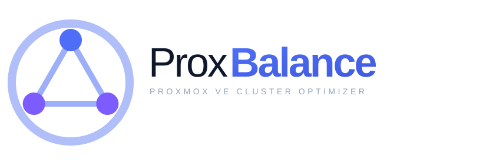

<div align="center">

<picture>
  <source media="(prefers-color-scheme: dark)" srcset="assets/logo_v3_dark.svg" width="700"/>
  <source media="(prefers-color-scheme: light)" srcset="assets/logo_v3.svg" width="700"/>
  
</picture>

<br/>
<br/>


[](https://opensource.org/licenses/MIT)
[](https://www.python.org/downloads/)
[](https://www.proxmox.com/)


**Cluster monitoring and VM/CT migration for Proxmox VE**

[Quick Start](#quick-start) | [Features](#features) | [Documentation](docs/README.md)

</div>

---

## What is ProxBalance?

ProxBalance is a web app that monitors a Proxmox VE cluster, scores each node with a penalty-based algorithm, suggests guest migrations, and can run them on a schedule. It runs in an LXC container on one of your nodes and talks to the Proxmox API with an API token.

<div align="center">

</div>

---

## Features

**Monitoring**
- CPU, memory, IOWait and disk use for every node and guest, with one **Headroom** score per node (0–100, higher means more room)
- A *Needs attention* strip that names the node and resource under pressure
- Node roles: each node that suggestions move guests off or onto is marked **Giving** or **Receiving** (or **Maintenance**) in the Nodes table, the Cluster Map and the node panel
- Cluster Map with 5 view modes, a find bar, drag-a-guest move preview, and the current suggestions drawn as arrows between nodes
- Charts: cluster health from 1 day to 1 year with migration markers, and one chart with every node on a shared time axis, with a Min/Max band for the highlighted node
- Node panel with the score breakdown ("Why N?"), disk health from SMART, and IO pressure (Proxmox VE 9)
- Guests tab that says for every guest whether ProxBalance can move it, and why not
- Quick search (Ctrl+K or Cmd+K, or /) to jump to any guest, node or page
- Wall-monitor mode (`#/wall`): a full-screen view for a screen on the wall
- Light and dark modes, and a layout that works on phones

**Insights**
- Per-node trends against the recommendation thresholds (24 h to 90 d)
- Forecast charts for each node metric heading for its limit within 30 days
- Workload rhythm heatmap with the quietest hours and your migration windows
- "What if a node fails?": where each guest would restart, and what wouldn't fit
- Rolling update plan: an order for updating or rebooting nodes one at a time, with quorum checks and where each guest would go (plan only)
- Right-sizing hints for guests whose vCPUs or memory don't match their use
- Measured outcomes of past migrations

**Migration**
- One-click migrations with progress and transfer speed
- Suggestions as one run-ordered list in waves, with batch impact per node, subset selection and conflict what-ifs
- Node maintenance mode with an evacuation plan that shows where each guest will land
- Placement rules from tags and Proxmox pools: anti-affinity (hard), affinity (soft or required), with **Enforce now** to fix broken hard rules
- Proxmox VE HA rules and target storage space are checked before every move

**Automation**
- Scheduled runs with migration windows and blackout periods, and a live "migrations allowed now" status
- Automatic or semi-automatic mode: in semi-automatic mode, most moves wait in an approval list
- Observation gating: a suggestion must persist across several runs before automation acts on it
- Safety checks: cluster health, quorum, target CPU and memory limits, rollback detection, a cap on moves into one node per run
- Dry run, on by default
- Change log of every migration, approval, setting change, tag change and update, with who or what made it

**Notifications**
- Pushover, Email (SMTP), Telegram, Discord, Slack and webhooks
- Alerts are sent once when a condition starts, not on every run, and can be silenced
- Each channel can be tested on its own

**Operations**
- Settings → Diagnostics: read-only checks of the API, token permissions, quorum, storage and ProxBalance's own services, with a copyable report
- Updates only to published, tested releases (stable, beta or dev channel), with a backup and automatic rollback
- Prometheus endpoint at `/api/metrics` and a Grafana dashboard
- Optional AI review of suggestions (OpenAI, Anthropic or Ollama)

See the [complete feature list](docs/FEATURES.md) for details.

---

## Quick Start

### Installation

Run on your Proxmox host:

```bash
bash -c "$(wget -qLO - https://raw.githubusercontent.com/Pr0zak/ProxBalance/main/install.sh)"
```

The installer creates an unprivileged LXC container, installs the dependencies, sets up the services and creates the API token.

### Access

Open `http://<container-ip>` in your browser.

---

## Screenshots

The screenshots come from a demo cluster with five nodes. Every page and tab has its own address, for example `#/dashboard/map` or `#/automation/filters`.

### Dashboard

<div align="center">

</div>

The top of the dashboard: the *Needs attention* strip, the KPI row and the automation status with the last 24 hours of checks. Below it, the Cluster card has five tabs.

<div align="center">
  <table>
    <tr>
      <td align="center" width="50%">
        
        <br/>
        <b>Nodes</b>: headroom, condition and role per node
      </td>
      <td align="center" width="50%">
        
        <br/>
        <b>Guests</b>: filters and a balancer verdict for every guest
      </td>
    </tr>
    <tr>
      <td align="center" width="50%">
        
        <br/>
        <b>Map</b>: guests per node, with planned moves as arrows
      </td>
      <td align="center" width="50%">
        
        <br/>
        <b>Charts</b>: cluster health and every node on one chart
      </td>
    </tr>
    <tr>
      <td align="center" width="50%">
        
        <br/>
        <b>Suggestions</b>: run order, batch impact per node, conflict what-ifs
      </td>
      <td align="center" width="50%">
        
        <br/>
        <b>Node panel</b>: load, score breakdown, disk health, IO pressure
      </td>
    </tr>
  </table>
</div>

### Insights, automation and settings

<div align="center">
  <table>
    <tr>
      <td align="center" width="50%">
        
        <br/>
        <b>Insights</b>: trends, forecast charts, workload rhythm
      </td>
      <td align="center" width="50%">
        
        <br/>
        <b>Rolling update plan</b>: one node at a time, with quorum
      </td>
    </tr>
    <tr>
      <td align="center" width="50%">
        
        <br/>
        <b>Automation</b>: quick setup and live schedule status
      </td>
      <td align="center" width="50%">
        
        <br/>
        <b>Waiting for approval</b>: semi-automatic mode
      </td>
    </tr>
    <tr>
      <td align="center" width="50%">
        
        <br/>
        <b>Guest rules</b>: hard and soft rules, Enforce now
      </td>
      <td align="center" width="50%">
        
        <br/>
        <b>Change log</b>: what changed, and who or what changed it
      </td>
    </tr>
    <tr>
      <td align="center" width="50%">
        
        <br/>
        <b>Settings</b>: sections with live status; secrets are never shown
      </td>
      <td align="center" width="50%">
        
        <br/>
        <b>Diagnostics</b>: read-only checks with a copyable report
      </td>
    </tr>
  </table>
</div>

### Other views

<div align="center">
  <table>
    <tr>
      <td align="center" width="50%">
        
        <br/>
        <b>Wall mode</b> (<code>#/wall</code>): full screen, no menus
      </td>
      <td align="center" width="50%">
        
        <br/>
        <b>Quick search</b>: Ctrl+K, Cmd+K or /
      </td>
    </tr>
    <tr>
      <td align="center" colspan="2">
        
        <br/>
        <b>Phone</b>: bottom tab bar and compact tables
      </td>
    </tr>
  </table>
</div>

---

## Documentation

| Document | Description |
|----------|-------------|
| [Installation Guide](docs/INSTALL.md) | Setup and configuration |
| [Usage Guide](docs/USAGE.md) | Workflows and UI guide |
| [Configuration Reference](docs/CONFIGURATION.md) | All config.json options |
| [Scoring Algorithm](docs/SCORING_ALGORITHM.md) | Penalty-based scoring system |
| [Automated Migrations](docs/AUTOMATION.md) | Modes, scheduling, placement rules and safety |
| [AI Features](docs/AI_FEATURES.md) | AI provider setup |
| [Notifications](docs/NOTIFICATIONS.md) | Alert providers and setup |
| [API Reference](docs/API.md) | REST API endpoints |
| [Releasing and Updating](docs/RELEASING.md) | Update channels, backups and rollback |
| [Prometheus Metrics](docs/PROMETHEUS.md) | `/api/metrics` and the Grafana dashboard |
| [Troubleshooting](docs/TROUBLESHOOTING.md) | Common issues and solutions |
| [Contributing](docs/CONTRIBUTING.md) | Development guidelines |

[Full documentation index](docs/README.md)

---

## System Requirements

- **Proxmox VE** 7.0 or higher. IO pressure needs Proxmox VE 9; HA rules are read on 9 and HA groups on 8
- **Resources**: 2 GB RAM, 2 CPU cores, 8 GB disk (minimum)
- **Network**: Connectivity to all cluster nodes on port 8006
- **Access**: Root access to Proxmox host

---

## Security

- API token authentication (no passwords stored)
- Secrets (Proxmox token secret, AI keys, notification credentials) are never returned by the API; the UI shows a masked placeholder, and saving the placeholder keeps the stored value
- Runs in an unprivileged LXC container
- Cross-site requests to the API are blocked (`csrf_protection`), and an optional `api_key` protects every endpoint except `/api/health`
- Designed for local network operation
- Optional SSL/TLS support

---

## Support

- **Bug Reports**: [GitHub Issues](https://github.com/Pr0zak/ProxBalance/issues)
- **Feature Requests**: [GitHub Discussions](https://github.com/Pr0zak/ProxBalance/discussions)
- **Troubleshooting**: [docs/TROUBLESHOOTING.md](docs/TROUBLESHOOTING.md)

---

## License

MIT License - see [LICENSE](LICENSE) for details.

---

<div align="center">

[Documentation](docs/README.md) | [Installation](docs/INSTALL.md) | [GitHub](https://github.com/Pr0zak/ProxBalance)

</div>
