# Usage Guide

---

## Finding Your Way Around

ProxBalance has four pages, reachable from the top nav on desktop and the bottom tab bar on phones:

| Page | What it is for |
|------|----------------|
| **Dashboard** | Live cluster state: nodes, guests, the cluster map, charts and migration suggestions |
| **Insights** | Analysis over time: node trends, forecasts, workload rhythm, node-failure simulation, rolling update plan, right-sizing and migration outcomes |
| **Automation** | Automated migration setup: on/off, dry run, mode, schedule, filters and placement rules, behaviour, history, logs and the change log |
| **Settings** | Connection, data collection, notifications, AI provider, system tools and diagnostics |

### Links and navigation

Every page and sub-tab has its own address, so you can bookmark or share a view and reload without losing your place:

- `#/dashboard/nodes`, `#/dashboard/guests`, `#/dashboard/map`, `#/dashboard/charts`, `#/dashboard/suggestions`
- `#/insights`
- `#/automation/schedule`, `#/automation/filters`, `#/automation/behavior`, `#/automation/history`, `#/automation/reference`
- `#/settings/connection`, `#/settings/collection`, `#/settings/notifications`, `#/settings/ai`, `#/settings/system`, `#/settings/diagnostics`
- `#/wall` for the [wall-monitor view](#wall-monitor-mode)

Side panels have addresses too, for example `#/dashboard/guest/100`. The browser's Back and Forward buttons move between views. If a page has unsaved edits, leaving it (by link, tab or Back/Forward) asks first.

### Quick search

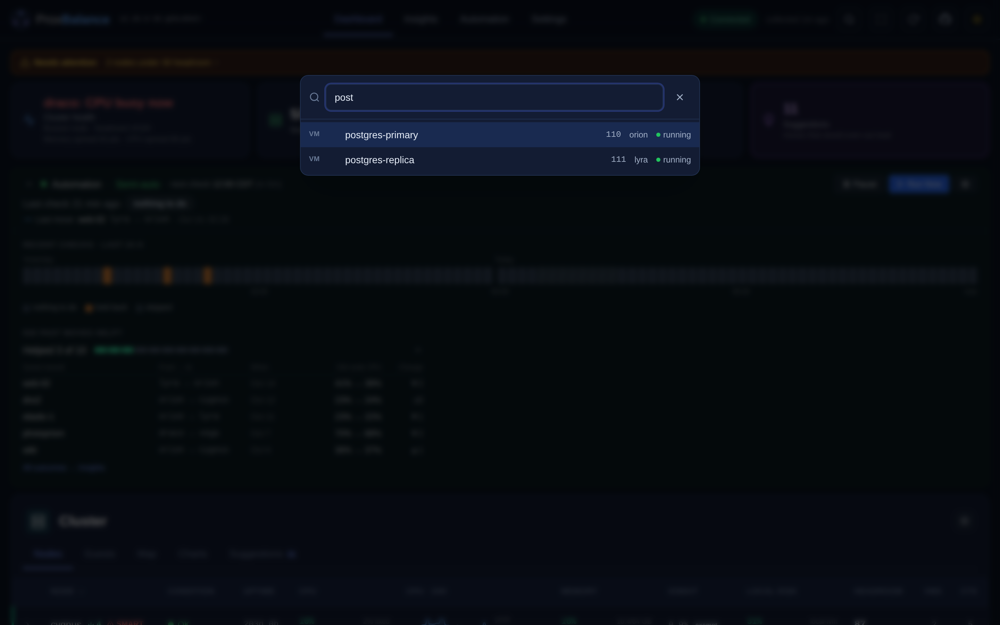

Press **Ctrl+K** (Cmd+K on a Mac) or **/** when no text field has focus, or click the search button in the top bar. Type part of a guest name, VMID, node name or page name, move with the arrow keys and press Enter. A guest or node opens its side panel; a page opens that page. Esc closes the search.

### Headroom

Each node gets a **Headroom** score out of 100. Higher means more room to take guests. The same name and colour scale are used everywhere (node table, KPI row, map, side panels and charts):

| Headroom | Colour | Meaning |
|----------|--------|---------|
| 50 and above | Neutral | Fine |
| 30 to 49 | Amber | Getting tight |
| Under 30 | Red | Under pressure |

The Cluster health tile on the dashboard reads the busiest node's headroom and says it in plain words: "All nodes have room" (with the node that has least room) when it is 50 or above, otherwise the busiest node and its biggest problem, for example "draco: disk wait high this week". Tap it for the per-node breakdown.

Headroom is 100 minus the node's penalty points (current and sustained load, IOWait, trends, spikes and so on). See [Scoring Algorithm](SCORING_ALGORITHM.md) for how penalties are calculated.

### Data age and errors

The header (and the phone tab bar) shows how old the collected data is, for example "collected 4m ago". It turns amber once the data is more than twice the collection interval old and red past three times.

If a request fails, the affected area says so ("status unavailable", "Couldn't load suggestions") with a Retry button, rather than showing a misleading default. Errors from actions such as saves, restarts, migrations and tag changes appear as short toast messages.

---

## Dashboard

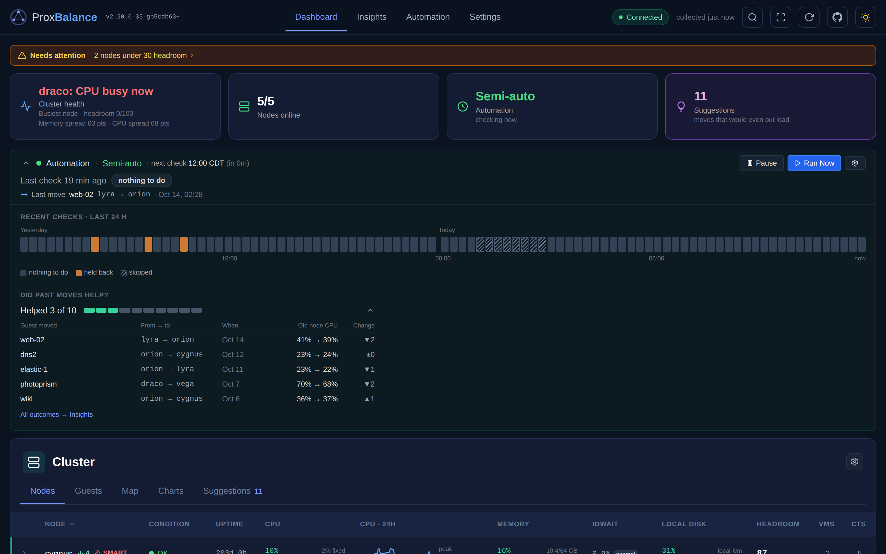

From top to bottom the Dashboard shows:

1. **Needs attention** strip: appears only when something needs you. It lists stale collector data, a failed last automation run, nodes in maintenance, and nodes with headroom under 30. Each item links to the relevant screen.
2. **KPI row**: Cluster Health (the tightest node's headroom and its largest penalty, with the mean in small text; click for a breakdown), Nodes Online, Total Guests, Active Migrations, Suggestions and Tagged. The cards are buttons: Nodes Online, Total Guests, Suggestions and Tagged open the matching Cluster tab, and Active Migrations opens an "In flight" list with source, target, progress and a Cancel button.
3. **Auto-migration banner**: whether automation is on, dry run or live, and when it can act. If the schedule is blocking it, the banner says when it can next act (for example "outside migration windows, can act next Sun 03:00") or which blackout is active. It also shows the last real move, a "watching N guests" toggle listing guests under observation, Pause/Resume for the timer, Run Now, and an expandable run history and migration outcomes panel. **Recent checks** is a strip of squares, one per check over the last 24 hours, labelled by day (Yesterday, Today): grey for nothing to do, violet for waiting, amber for would move, filled for moved, red for failed, hatched for skipped, and a hollow square for a move that needs approval. Tap a square to see that check. In semi-automatic mode a "N moves waiting for approval" link opens the approval list.
4. **PVE CRS banner**: if Proxmox's own Cluster Resource Scheduler is configured, a quiet one-line summary with Details and Edit. It only becomes a full warning when CRS and ProxBalance could fight over the same guests.
5. **Cluster card** with five tabs: Nodes, Guests, Map, Charts and Suggestions.

Use the layout menu (gear icon on the Cluster card) to promote Suggestions, Map or Charts out of the tabs into their own sections on the page.

### Nodes tab

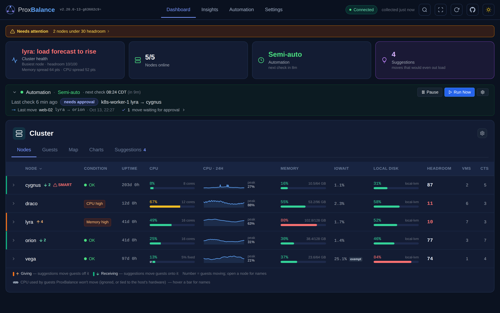

One row per node with CPU, memory, IOWait, local disk, uptime, VM/CT counts and Headroom.

- **Role** marker next to the node name, only for nodes that current suggestions involve: **Giving** (up arrow, guests move off it) or **Receiving** (down arrow, guests move onto it), with the number of guests. A node that is both shows the net direction; hover for both counts and the guest names. **Maintenance** (wrench) marks a node in maintenance. A legend under the table lists the roles present.
- A red **⚠ SMART** marker next to the name means a disk on that node failed SMART. Open the node for details.
- **Condition** shows Offline or Maintenance when that applies, otherwise the node's largest penalty as a chip (for example "RAM alloc +18"), or OK.
- **Local disk** shows the fullest local storage pool and its name. Shared storage (NFS, CIFS, PBS, Ceph and similar) is left out so a shared NAS does not colour every node the same.
- **Expanding a node** lists its guests sorted by share of the node's CPU, with sortable CPU, Memory, Disk I/O and Network columns and a total for the running guests. Stopped guests are folded into one expandable row.

Click a node name to open its side panel.

### Guests tab

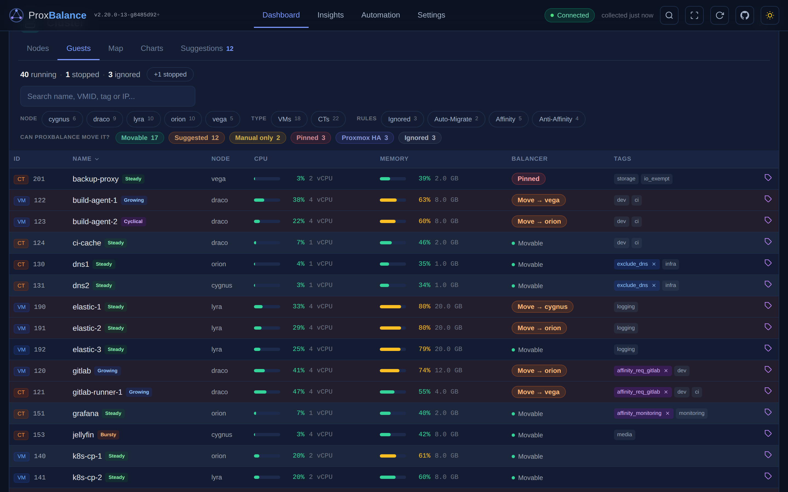

A compact, sortable list of every guest with state, CPU and memory bars, allocation, tags and a Balancer verdict.

**Search** matches name, VMID and any Proxmox tag (including IP tags).

**Filters** are grouped chips: Node, Type (VMs, CTs), State (Running, Stopped), Rules (Ignored, Auto-Migrate, Affinity, Anti-Affinity) and Balancer. Chips inside a group combine with OR, groups combine with AND. Each chip shows a live count, chips with no matches fade out, and a "N of M guests" counter and Clear filters action sit beside the search.

**"Can ProxBalance move it?"** The Balancer column gives one verdict per guest:

| Verdict | Meaning |
|---------|---------|
| Suggested | There is a current suggestion for it; a Move button opens the migrate dialog |
| Movable | Eligible, but no move is needed right now. The tooltip names the exact gate (for example "vega mem 45% < 65% floor") |
| Manual only | Needs manual steps (for example unshared bind mounts) |
| Pinned | Cannot migrate (for example passthrough or local disks) |
| HA / CRS | Managed by Proxmox HA, which the native CRS balances |
| Ignored | Carries the `ignore` tag |
| Stopped | Not running |

A counting strip above the table filters by verdict. A guest using most of its own RAM also gets a note that this is pressure inside the guest, which a migration would not relieve.

Tag chips have a remove (x) button and the tag icon opens the tag dialog (see [Tagging](#tagging)).

### Map tab

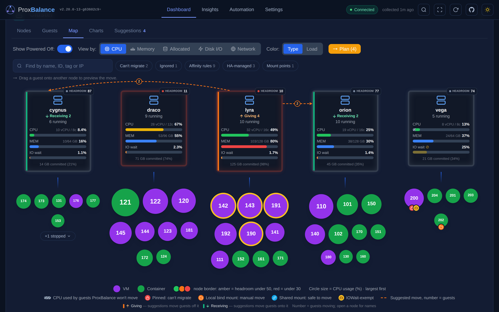

A visual view of each node and its guests as bubbles.

- **View by**: CPU, Memory, Allocated, Disk I/O or Network sizes the bubbles. **Color** switches between guest type and load.
- **Node cards** print their values: CPU % with allocated vCPU over physical cores, memory % with used/total GB, IOWait %, and committed RAM (orange above 100%). Node role markers appear here as on the Nodes tab.
- **Planned moves**: current suggestions are drawn as dashed arrows from source to target node, one per node pair, with the number of guests in the middle. Hover or tap the number for the guest names. Moves waiting for approval (semi-automatic mode) are dotted blue. Arrows disappear once their moves run. The **Plan (N)** button hides the arrows; **Show plan (N)** brings them back. The choice is remembered per browser.
- **Find bar**: type a guest name, VMID or tag. Matches are ringed and labelled, everything else dims, each node shows how many matches it holds, and Enter opens the guest when exactly one matches. Quick-filter chips pick out guests that can't migrate, are ignored, carry affinity rules, are HA-managed or have mount points.
- **Guest indicators**: a small square on a container means it has mount points (cyan when shared and safe to migrate, orange for unshared bind mounts that need manual work); a red square on a VM means pinned or passthrough disks, which cannot migrate.

**Previewing a move.** Drag a guest bubble over another node to see ghost bars and an "If here (est.)" readout; the source shows what it would free. Offline, maintenance and pinned cases refuse the drop. Dropping opens a before/after panel that flags anti-affinity or split-affinity conflicts, overcommit, CPU over 80% or memory over 85%, unshared bind mounts, the ignore tag and HA management. "Review migration..." hands off to the normal Confirm Migration dialog, so nothing starts from the map itself. On touch screens, tap a bubble to get a "Move to..." sheet with each node's estimate instead of dragging. All projections are estimates from current usage.

### Charts tab

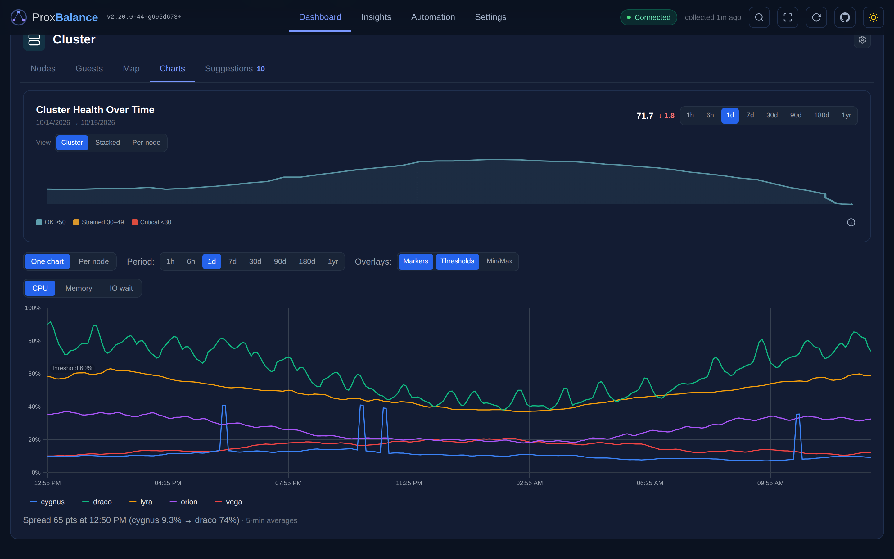

**Cluster Health Over Time** plots headroom from 1 day to 1 year, in three views: **Cluster** (one line), **Stacked** and **Per-node**. Background bands use the headroom colour scale.

- Migration markers sit along the time axis. Hovering near a marker snaps the cursor to it and the tooltip lists the migrations in that group.
- Click (or tap) to **pin a moment**. A panel shows each node's headroom, CPU and memory at that time, the change from about 24 hours earlier, the lowest node, and the migrations around that time with their reasons. Clicking on a marker pins that migration's own time.
- While a moment is pinned, the arrow buttons or the **Left/Right arrow keys** step to the previous or next migration. X, Esc or clicking the same point again unpins; changing the period clears the pin.

**Node charts** show CPU, memory and IOWait per node for 1 hour up to 1 year, with Markers, Thresholds and Min/Max toggles.

- **One chart** (the default) puts every node on one time axis, one metric at a time (CPU, Memory or IO wait). The recommendation threshold is a thin dashed line. Click a node name under the chart to hide or show it; hover a name to highlight its line. Click a line to highlight that node and show only its migration markers (click again or "Clear highlight" to undo). With **Min/Max** on, the highlighted node also gets its min/max band, visible where samples are averaged. Lines use the raw samples at 1h and 7d, 2-minute averages at 6h, 5-minute averages at 1d, and 2-hour, 6-hour, 12-hour and 1-day averages at 30d, 90d, 180d and 1yr. The line under the chart gives the spread right now, for example "Spread now: 24 pts (orion 26% → vega 50%)", and names the average in use. A node that was offline shows a gap. On phones only the metric control stays above the chart; layout, period and overlays sit behind an **Options** button.
- **Per node** gives one chart per node (the choice between One chart and Per node is remembered). Each card header shows status, cores, guest count and a Headroom badge. The CPU/Mem/IOWait chips act as the legend: click one to hide or show that series on every card.

### Suggestions tab

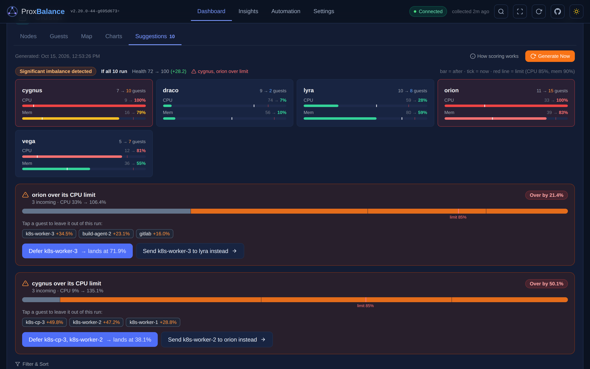

Migration suggestions from the penalty-based engine, as **one list in run order**. Cards are grouped under **Wave** dividers with step numbers; moves in the same wave can run in parallel.

- **Impact strip**: cluster health before and after, plus one tile per node with its predicted load. A tile turns red when it would cross the safety limit.
- **Cards**: source and target, reason, confidence, headroom gain, "Why this migration?" and "Show command". After a migration completes, a Rollback button can move the guest back.
- **Filters**: minimum confidence, source node, target node and sort order. If a filter hides everything, the list says so.
- **Selecting a subset**: tick cards, or use the quick-select chips (all, From a node, Only non-conflicting). A floating bar summarises the selection (flows, RAM, estimated time, moves into an over-limit node) with **Run selected** and **Copy commands** (the `qm`/`pct` lines grouped by wave).
- **Run all N in order** opens the Run Plan dialog for the whole list. Run Plan executes wave by wave and halts if a migration fails.
- **Conflicts**: when several moves would overload the same target, a what-if panel shows a stacked memory or CPU bar against the limit. You can leave individual moves out of this run (chips restore them), use the computed "Defer X, lands at Y%" button, or "Send X to Y instead", which opens the migrate dialog with the engine's alternative target. The strip, numbering and badges recompute as you go.
- **Not recommended** groups the guests the engine skipped by reason in plain words (for example "Node healthy, no need to move"). Click a reason to see its guests.

If AI recommendations are enabled, an AI section appears on the Dashboard as well (see [AI Recommendations](#ai-recommendations)).

---

## Node and Guest Panels

### Node panel

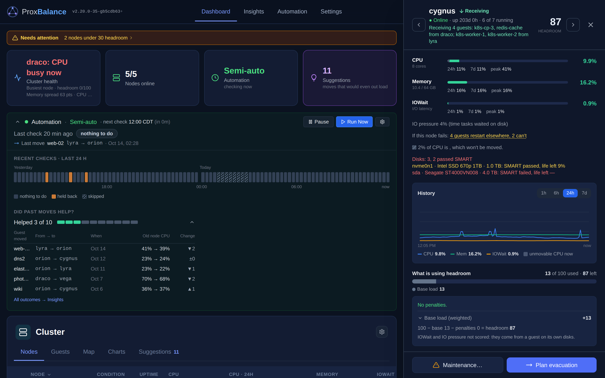

Click a node in the table, map or charts, or find it with quick search. The panel leads with status, uptime, the VM/CT split, the node's role and a large Headroom score, then:

- **Load**: CPU, memory and IOWait now, with 24h and 7d averages and the peak. On Proxmox VE 9, **IO pressure** (the share of time tasks waited on disk) is shown under IOWait.
- **What is using headroom**: a bar on a fixed 100-point track showing base load plus each penalty category in points ("N of 100 pts used, M left"). **Why N?** lists each penalty with the reading behind it, for example "CPU peak this week 82% (over 80%) +10".
- **Disks**: one line for the node's disks, such as "Disks: 6, all passed SMART". A disk that fails SMART, reports unknown health or has 20% of its life left or less gets its own line. Hover for the per-disk verdict and life left.
- **If this node fails**: one line from the node-failure simulation, with a link to the card on Insights.
- **Recommendations** involving this node.
- **Maintenance** and **Plan evacuation** buttons (see [Node Maintenance](#node-maintenance)).

### Guest panel

Click a guest anywhere in the UI to see CPU and memory with history, disk and network I/O, tags, mount points or passthrough disks, and its behaviour profile.

The **Move to** cards list each possible target with the guest's headroom there, the gain versus staying, the load after the move, an overcommit warning and a **Best** badge. "Move here" (or the footer's "Move to <best>") opens the Confirm Migration dialog. The panel also has an **Exempt from IOWait** toggle, which sets the `io_exempt` tag.

---

## Node Maintenance

Maintenance mode is stored on the server, so it applies in every browser until someone exits it.

1. Open the node panel and click **Enter maintenance...**
2. Read the confirmation. It says what will actually happen:
   - With live automation, the next run starts moving the node's guests off (up to the per-run limit, bypassing observation, cooldown and ignore tags).
   - With dry run or automation off, nothing moves on its own.
3. Click **Plan evacuation** to review the plan (nothing moves until you confirm):
   - A **Where it lands** strip shows each target node's RAM and CPU now and after the moves, turning red past 85%.
   - A summary counts guests to migrate, left in place, unable to move and restarting.
   - Each guest has an action (Migrate, Ignore, Power Off) and a target. **Send all to** sets every target at once, or returns to the automatic spread.
   - Targets that lack one of a guest's storages are flagged.
   - Stopped guests are ignored by default; tick "Include stopped guests" to move their disks too.
4. Confirm. The confirm screen groups guests by target with each target's projected load. The exact action and target shown for each guest is what gets executed; a guest the chosen node cannot take fails and stays put instead of being sent elsewhere.
5. Do the maintenance work.
6. Open the node panel again and click **Exit** to return it to the pool.

While in maintenance, no guests are placed on the node: recommendations, automation and evacuation plans all skip it as a target.

---

## Manual Migration

### Single guest

1. Start from any of these:
   - the Move button on a Guests tab row or suggestion card
   - a "Move to" card in the guest panel
   - dragging a bubble on the Map and choosing "Review migration..."
2. Check the target node in the Migrate dialog and confirm.
3. Watch progress on the card or in the **Active Migrations** KPI ("In flight" list), which can also cancel a migration.

A migration counts as successful only when the Proxmox task finishes with status OK. Any other result is shown as failed with the task's error text. If ProxBalance loses track of a task, it reports the outcome as unknown so you can check Proxmox.

### Several guests

On the Suggestions tab, use **Run all N in order** or select a subset and use **Run selected**. Both open the Run Plan dialog, which runs the moves wave by wave. To run them yourself, use **Copy commands**.

### Containers with mount points

- **Shared storage mounts** (cyan indicator): safe to migrate. The target node reconnects to the same shared storage.
- **Unshared bind mounts** (orange indicator): need manual data migration or mount point setup on the target first.

### VMs with passthrough disks

VMs with passthrough or pinned local disks (red indicator) are excluded from migration suggestions. They need manual work: shut down the VM, move or reconfigure the disk on the target node, and start the VM there.

---

## Tagging

### Tag types

| Tag | Effect |
|-----|--------|
| `ignore` | Excluded from automated migration recommendations |
| `no-auto-migrate` | Excluded from automated migration (alternative to `ignore`) |
| `exclude_<group>` | Anti-affinity (hard): guests with the same tag are kept on different nodes |
| `affinity_<group>` | Affinity (soft): moving a guest away from its group costs score points, but is allowed |
| `affinity_req_<group>` | Required affinity (hard): the group `affinity_<group>` moves together. One member with this tag makes the whole group required |
| `auto_migrate_ok` | Whitelist mode: only tagged guests are auto-migrated (when enabled; `auto-migrate-ok` also works) |
| `io_exempt` | Guest's IOWait is left out of its node's scoring |

### Applying tags

**Via Proxmox CLI:**
```bash
pvesh set /nodes/<node>/qemu/<vmid>/config --tags "ignore"
pvesh set /nodes/<node>/qemu/<vmid>/config --tags "exclude_database"
pvesh set /nodes/<node>/qemu/<vmid>/config --tags "affinity_webstack"
pvesh set /nodes/<node>/qemu/<vmid>/config --tags "ignore;exclude_prod"
```

**Via ProxBalance web UI:**
On the Guests tab (or a guest in the expanded Nodes table), click the tag icon to open the tag dialog. It has a Quick Add for `ignore` and a field for any other tag, such as `exclude_database` or `affinity_web`. Remove a tag with the x on its chip. The guest's tags refresh immediately without a full collection. Editing tags needs an API token with write permissions.

**Via Proxmox web UI:**
Navigate to the VM/CT > Options > Tags.

**Tag rules:**
- Lowercase only (`ignore`, not `Ignore`)
- No spaces in tag names (use underscores)
- Separate multiple tags with semicolons or spaces
- Anti-affinity tags must start with `exclude_`
- Affinity tags must start with `affinity_` (`affinity_req_` for required)
- Exact match required (`exclude_db` and `exclude_database` are different groups)

After changing tags outside ProxBalance, trigger a refresh:
```bash
curl -X POST http://<container-ip>/api/refresh
```

You can also refresh tags for a single guest without a full collection cycle:
```bash
curl -X POST http://<container-ip>/api/guests/<vmid>/tags/refresh
```

---

## Insights

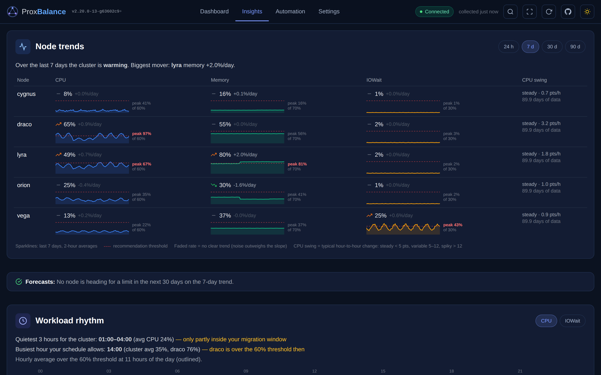

The Insights page shows analysis the backend computes over time.

- **Node trends**: for each node, the direction, current average and rate of change of CPU, memory and IOWait, plus stability and data coverage. Pick a 24h, 7d, 30d or 90d window (remembered per browser). Each cell has a sparkline scaled to the threshold, with the peak in red if the threshold was crossed. Time-to-threshold is shown only for confident fits; a faded rate means there is no clear trend (hover for r²). Confident threshold crossings projected within a year are listed in an amber line.
- **Forecasts**: one chart per node metric heading for its limit within 30 days: the history, a dashed line continuing the trend, a marker at now and a dashed line at the limit. Each chart has one headline, for example "cygnus memory reaches 80% in about 12 days"; medium-confidence fits add "rough estimate", and **Details** shows the fit. At most three charts show, soonest first; **Show all** shows the rest. When nothing is heading for a limit, the card is one line.
- **Workload rhythm**: an hour-of-day heatmap over 30 days per node, in the automation schedule's time zone. Hours over the threshold are outlined, and an **Allowed** strip shows when your migration and blackout windows permit moves. Summary lines give the quietest stretch, the busiest allowed hour and the over-threshold hours, with a link to edit the migration windows.
- **What if a node fails?**: pick a node to see where its running guests would restart, which can't restart elsewhere and which don't fit, with each remaining node's memory before and after. Each node has a chip (can fail, tight, can't restart, left out). By default guests on node-local disks are assumed restored elsewhere; the **Unplanned failure** toggle shows them as unable to restart.
- **Rolling update plan**: see below.
- **Right-sizing**: guests whose vCPUs or memory don't match their last 7 days of use. Totals count VMs only; container hints are in a collapsed group, because container limits are not reserved on the host.
- **Migration outcomes**: did recent migrations actually relieve the source node? Source-node CPU and memory before each move versus 5 minutes and 24 hours after. Outcomes are recorded for manual, automated and affinity-companion migrations. Records whose after-snapshots were taken long after the move are counted but not shown, because they don't measure the migration.

On phones, the trends table becomes one block per node.

### Rolling update plan

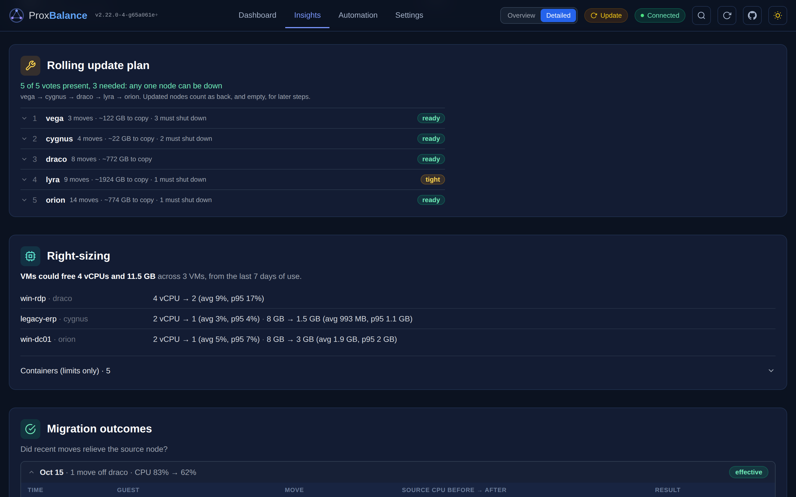

Use this card before updating or rebooting the nodes one at a time. It only plans: nothing is migrated, updated or rebooted.

1. Check the **Quorum** line: votes present, votes needed, and whether any one node can go down. Two-node clusters, QDevices and nodes already offline are flagged.
2. Read the steps in order. Nodes with the fewest guests to move come first; the node that runs ProxBalance comes last. Each step lists where each running guest would go, the guests that must shut down (passed-through hardware or node-local bind mounts), each target's memory after the moves, and how much node-local disk data would be copied. A step is marked tight when a target ends above 85% memory, and short when a guest doesn't fit.
3. For the first node, click **Start maintenance on <node>**. This opens the node panel and the normal maintenance flow. Update the node, exit maintenance, and continue with the next step.

ProxBalance finds its own guest by `rolling_update.self_vmid` in the config, else a guest named like the container's hostname, else a guest named `proxbalance`.

---

## AI Recommendations

### Setup

1. Open **Settings > AI**
2. Turn on AI-enhanced recommendations
3. Select a provider:
   - **OpenAI**: API key from platform.openai.com
   - **Anthropic**: API key from console.anthropic.com (starts with `sk-ant-`)
   - **Ollama**: Base URL of your Ollama instance (e.g., `http://server:11434`)
4. Choose a model
5. Click **Save changes** in the unsaved-changes bar

### Generating recommendations

On the Dashboard, the AI section appears once AI is enabled. Choose an analysis period (last hour, 6 hours, 24 hours, 7 days or 30 days) and click **Get AI Analysis**. The AI analyses cluster metrics over that period and returns recommendations with:

- Priority level (high/medium/low)
- Natural language reasoning
- Risk score (0.0 to 1.0)
- Estimated impact
- Suggested timing

AI recommendations appear separately from the penalty-based suggestions. Both can be used together.

See [AI Features](AI_FEATURES.md) for provider details and model selection.

---

## Automated Migrations

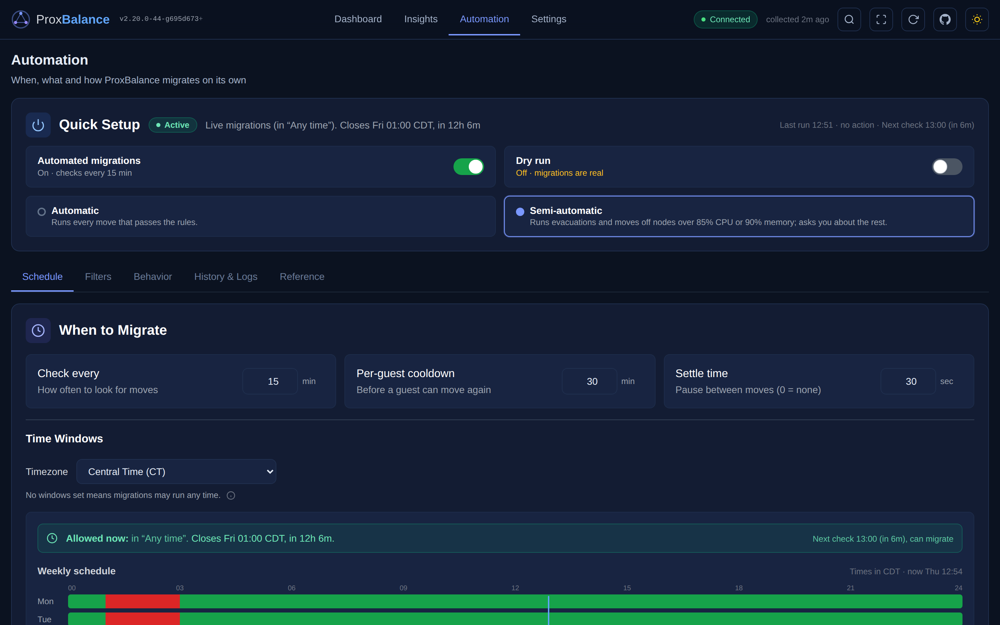

### Quick Setup

The top of the Automation page is one status line (state, reason, last run and its result, next check) over three tiles:

- **Automated migrations**: on/off
- **Dry run**: when on, runs only log what they would do. When off, it reads "Off, migrations are real" in amber.
- **Mode**: **Automatic** (automation runs every move that passes the rules) or **Semi-automatic** (see below)
- **Sensitivity**: Conservative, Balanced or Aggressive

The on/off and dry-run switches take effect immediately, each with its own confirmation, and so does a change of mode. Start with dry run on to test behaviour.

### Approving moves (semi-automatic mode)

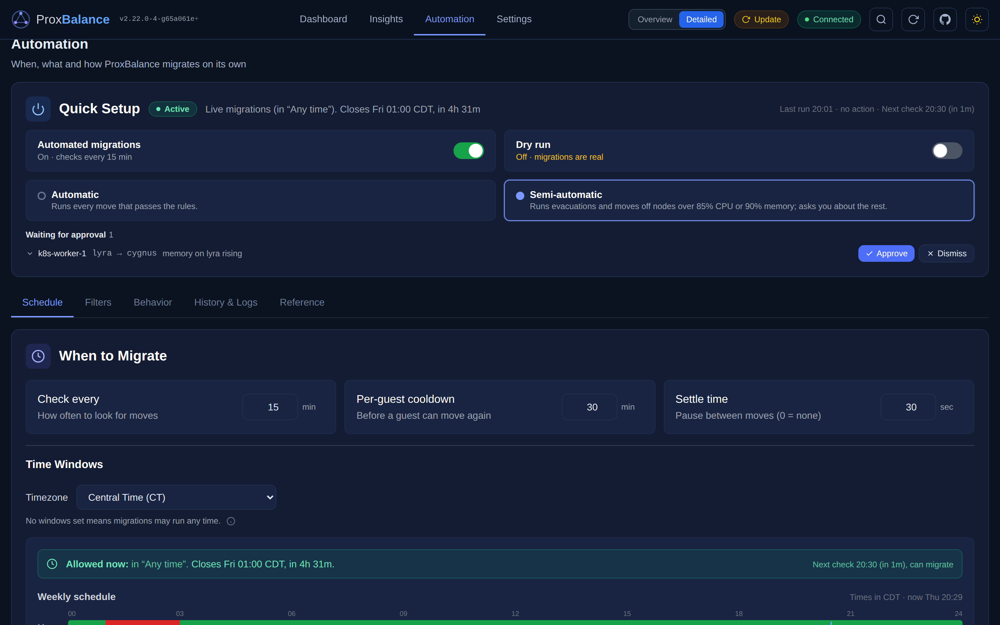

In semi-automatic mode automation runs only maintenance evacuations and moves off a node over its CPU (85%) or memory (90%) safety limit on its own. Every other move is listed under **Waiting for approval** in Quick Setup: guest, from → to and why, with the full reason, confidence and expiry behind the row's arrow.

- **Approve** runs the move with every check done again. If a check fails now (for example outside the migration window), the move stays approved and runs on a later check.
- **Dismiss** hides the move until it expires or its target changes.
- An entry expires after 24 hours (`approval_ttl_hours`) or when its suggestion goes away.
- With dry run on, nothing is queued and Approve is disabled.

The dashboard shows "N moves waiting for approval", and queued moves appear as hollow squares in Recent checks. The "Waiting for approval" notification is sent once per guest.

### Tabs

- **Schedule**: check interval, per-VM cooldown, settle time between migrations, and migration and blackout time windows (each with days of week and its own time zone). A status line says plainly whether migrations are allowed right now and why, for example "Migrations blocked now: blackout ... Opens today 10:40, in 3h 30m. Next check 07:30, will skip". A weekly grid shows all windows on one hour axis with a "now" line. Window cards show Every day / Weekdays, flag overnight and disabled windows, and mark the one that is active now. Note that a window list where every window is disabled blocks all runs, while an empty list allows any time.
- **Filters**: guest rules (skip ignored guests, require the whitelist tag, respect affinity rules, keep anti-affinity groups apart, allow container restarts) with the [placement rules list](#placement-rules), limits (minimum confidence, max migrations per run, max concurrent migrations, max into one node per run), the recommendation threshold sliders for CPU, memory and IOWait, and distribution balancing. Each threshold slider shows every online node as a tick at its current value, shades the trigger zone, and says which nodes are over now and which crossed in the last 24 hours.
- **Behavior**: safety checks (cluster health with max node CPU/memory, verify guest location, stop remaining migrations on failure, auto-disable on failure), smart migrations, and scoring and sensitivity, including penalty weights and a what-if simulator.
- **History & Logs**: three tabs. **Migration History** (target headroom, duration, reason and status, paged 5 to 100 per page), **Script Logs** (the automation service log) and **Change log** (see below).
- **Reference**: how the decision process and scoring work.

### Placement rules

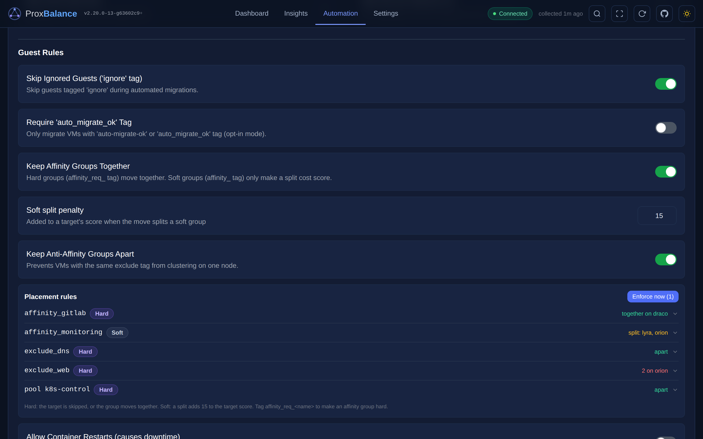

**Automation → Filters → Guest Rules** lists every rule from `exclude_*`, `affinity_*` and `affinity_req_*` tags and from pool rules. Each rule is marked **Hard** or **Soft** and shows whether it holds now and where its members run; expand a rule to see its members.

When a hard rule is broken (two anti-affinity members on one node, or a required group split across nodes), click **Enforce now**. A dialog lists the moves that would fix it and any guests it can't move. Confirm to run the moves. With dry run on, nothing moves and the dialog says so. Soft rules are never enforced. See [Automation](AUTOMATION.md#placement-rules-list-and-enforce-now).

### Change log

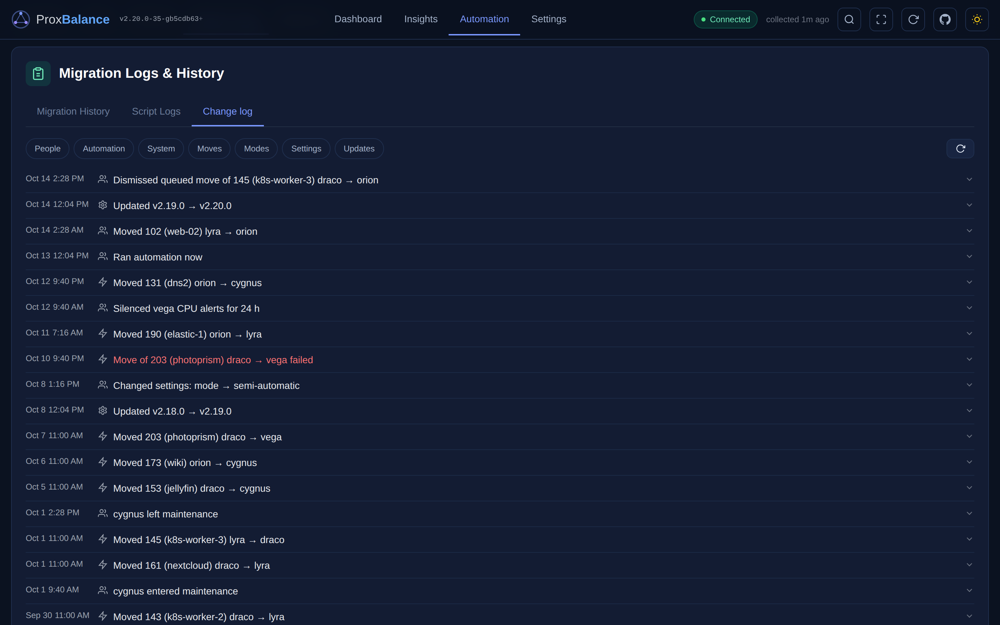

**Automation → History & Logs → Change log** lists what changed, newest first. Each line shows the time, an icon for the source (a person, automation or the system) and one sentence, for example "draco entered maintenance". It records migrations (manual, batches, rollbacks, evacuations, Enforce now, automation's moves and failures), approvals, setting changes (names of the changed settings only, never values), tag changes, alert silences, Run Now, service restarts and updates.

Filter by source or type, and tap a line for details. For requests from a browser, the client address is recorded. Entries are kept for 180 days.

### Saving

Everything except the on/off and dry-run switches is staged. A sticky bar shows "N unsaved changes" with **Discard** and **Save changes**, and saves all edits together. Edits survive switching tabs, and leaving the page with pending edits asks first. Reset-to-defaults buttons confirm before they act.

### Monitoring

- The Dashboard's auto-migration banner and **Needs attention** strip show the current state, the next time automation can act, and failed runs.
- **Run Now** on the banner triggers a run immediately. It uses your configured dry-run setting and exits early outside migration windows.
- The **Active Migrations** KPI lists migrations in flight.
- **Automation > History & Logs** has the full history, the service log and the change log.
- **Insights > Migration outcomes** shows whether moves helped.

The API's test run (`POST /api/automigrate/test`) is always a dry run: it never migrates, sends no notifications and records no observations.

### Command-line monitoring

```bash
# Follow automation logs
pct exec <ctid> -- journalctl -u proxmox-balance-automigrate.service -f

# View recent migrations
pct exec <ctid> -- journalctl -u proxmox-balance-automigrate.service -n 100

# Search for a specific guest
pct exec <ctid> -- journalctl -u proxmox-balance-automigrate.service | grep "VM 120"
```

See [Automated Migrations Guide](AUTOMATION.md) for full configuration details.

---

## Settings

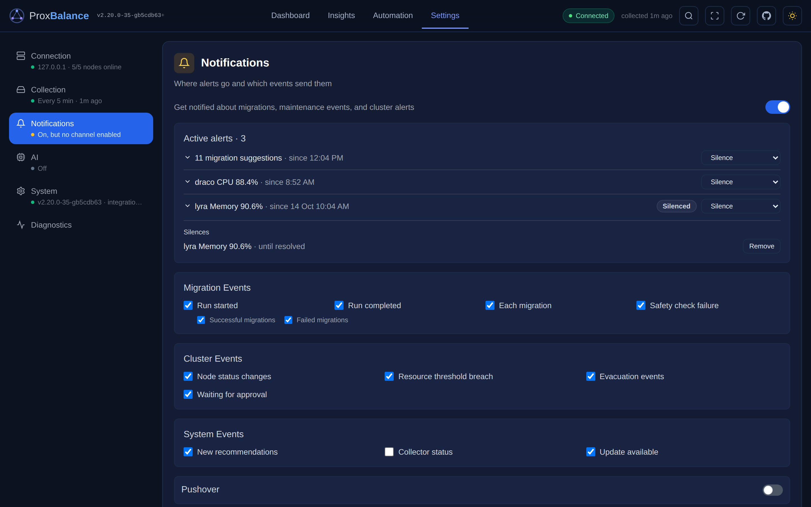

Settings has a side nav on desktop and a row of pills on phones. Each section shows a one-line live status with a coloured dot, and an "N unsaved" badge when it has pending edits.

### Sections

- **Connection**: Proxmox host and API token (ID and secret), with token validation. Status shows the host and how many nodes are online.
- **Collection**: cluster size preset (choosing one fills in the fields; editing a field switches to Custom), collection interval, parallel collection and worker count, skipping RRD for stopped guests, and the dashboard auto-refresh interval. Status shows the interval and the age of the last run, amber once two runs in a row were missed.
- **Notifications**: channels (Pushover, Email/SMTP, Telegram, Discord, Slack, generic webhook) and which migration, cluster and system events send alerts. **Active alerts** lists the alerts that are active now; each can be silenced for 1 h, 8 h, 24 h or until it resolves, on its own or for its whole type, and active silences have a Remove button. See [Notifications](NOTIFICATIONS.md#alerts-repeats-and-silences). Each channel shows its state (ready, skipped with the reason, last test result) and has its own **Test** button; **Test all enabled channels** reports a summary such as "1 sent, 1 failed, 1 skipped". Tests use the saved settings, so they are disabled while notification edits are unsaved.
- **AI**: provider, model and API key or Ollama URL. Status shows the provider and model, or Off.
- **System**: compact lists for **Services** (API service and data collector, each with **View log**, an inline viewer over the last 1000 journal lines with a warnings-and-errors filter, Refresh and Download, and **Restart** with inline confirmation), **Export data** (cluster snapshot as JSON, guest list as CSV) and **Configuration backup** (export settings, import settings, and backup on the server). Status shows the running version or that an update is available.
- **Diagnostics**: read-only checks, run when the section opens (see [Diagnostics](#diagnostics)).

Recommendation thresholds and penalty scoring live on the Automation page (Filters and Behavior tabs).

Settings uses the same save model as Automation: edits are staged and saved from the "N unsaved changes, Discard, Save changes" bar.

### Secrets

API tokens, notification credentials and AI keys are never returned by the API. They appear as masked placeholders in the forms. Saving a form with the placeholder unchanged keeps the stored secret; type a new value to replace it. Exported configuration also carries placeholders, and importing it back keeps the stored values.

### Updates

The version number in the top nav opens the update window from any page: pick the update channel (stable, beta or dev), read the release notes and update. See [Releasing and updating](RELEASING.md).

---

## Wall-monitor mode

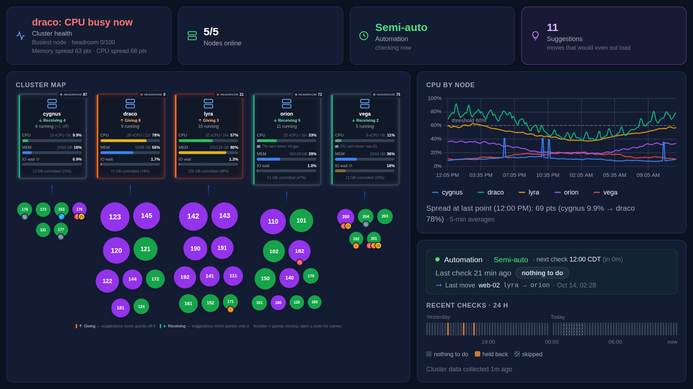

Click the full-screen button in the top bar (large screens), or open `#/wall`. The view shows the summary row, the Cluster Map, CPU per node and automation status with the last 24 hours of checks, and nothing else: no menus, side panels or search. It fills the screen at 1080p and 1440p without scrolling and asks the browser to keep the screen awake. To leave, press Esc, leave full screen, or move the mouse and click **Exit**. On a phone the same content is a normal scrolling page.

---

## Mobile

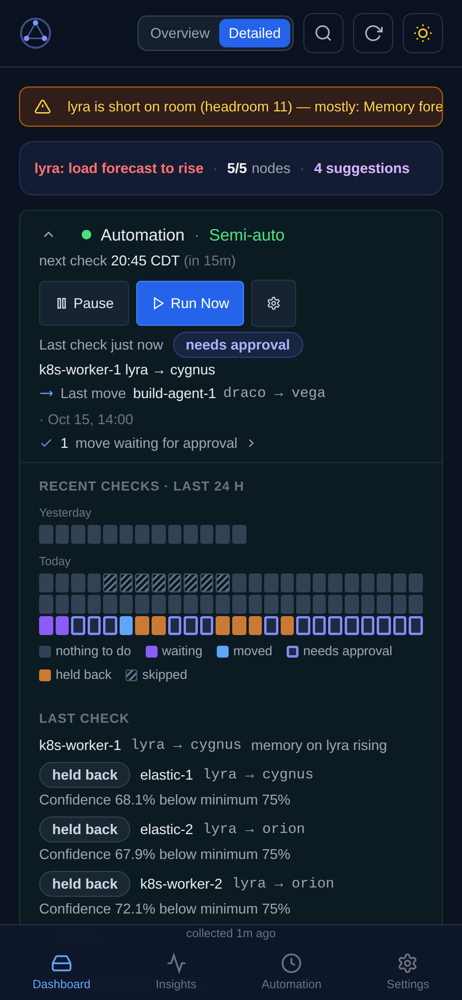

The layout works on phones:

- A bottom tab bar replaces the top-nav page links and shows the data age.
- The Cluster tabs scroll sideways, and tables show a reduced set of columns (for example Node, CPU, Memory and Headroom on the Nodes tab).
- The Map uses a tap-to-move sheet instead of drag and drop.
- Dialogs fit the screen with internal scrolling.
- Save bars and the Run Plan pill sit above the tab bar.

---

## Diagnostics

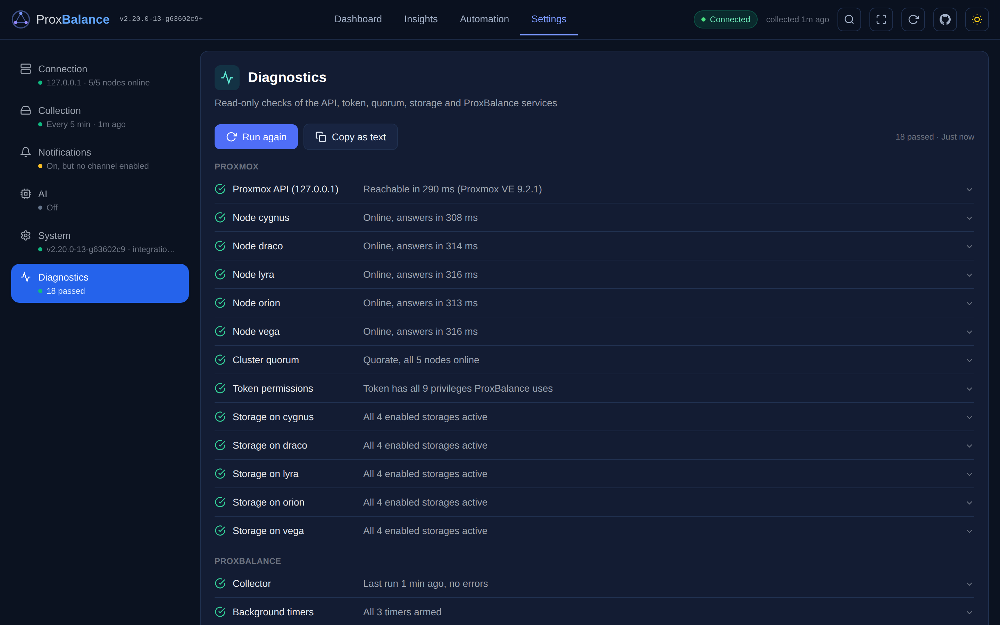

### Settings → Diagnostics

Open **Settings → Diagnostics**. The checks run when the section opens; **Run again** repeats them. Each check is one line with a pass, warn or fail mark: Proxmox API reachability and latency, each node, cluster quorum, token permissions (naming what stops working without each one), storage state per node, the collector, timers, the database, cache age and updates. Click a line for details. **Copy as text** copies a report with secrets removed, for a bug report. The checks are read-only. The same data is at `GET /api/diagnostics`.

### Status checker

```bash
bash -c "$(wget -qLO - https://raw.githubusercontent.com/Pr0zak/ProxBalance/main/check-status.sh)" _ <container-id>
```

### Service debugger

```bash
bash -c "$(wget -qLO - https://raw.githubusercontent.com/Pr0zak/ProxBalance/main/debug-services.sh)" _ <container-id>
```

### Manual checks

```bash
pct exec <ctid> -- systemctl status proxmox-balance proxmox-collector.timer nginx
curl http://<container-ip>/api/health
pct exec <ctid> -- journalctl -u proxmox-balance -n 50
```

Service logs can also be viewed from **Settings > System > Services > View log**.

For detailed troubleshooting, see [Troubleshooting](TROUBLESHOOTING.md).

---

[Back to Documentation](README.md)
